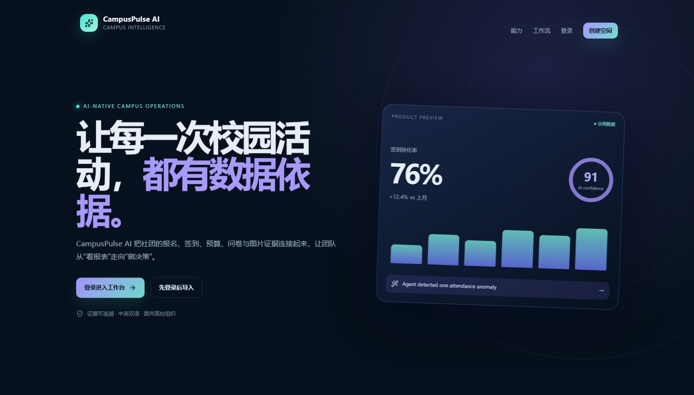
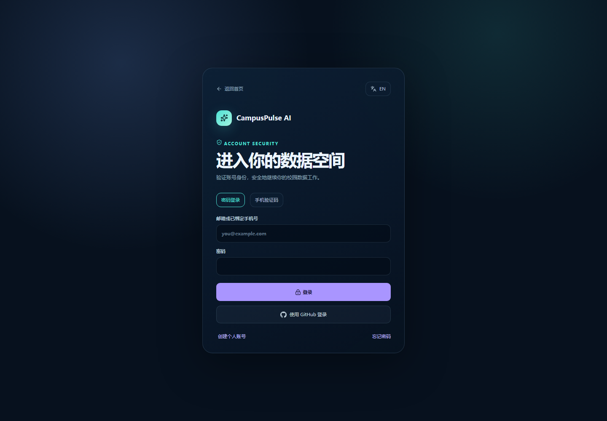

# CampusPulse AI 作品介绍

更新日期：2026 年 11 月 10 日

## 项目概况

| 项目 | 内容 |
| --- | --- |
| 项目名称 | CampusPulse AI——高校社团运营数据工作台 |
| 参赛项目 | 第九届传智杯 Web 网页开发挑战赛，Web 网页开发方向 |
| 开发成员 | 郑宇豪、尤一龙、关博然 |
| 指导教师 | 冯玉雷、张兴华 |
| 在线演示 | https://cam.yuhaocloud.cn |
| GitHub | https://github.com/yuhao139088/campuspulse-ai |

图 1：在线首页的产品预览区。首页展示的置信度与业务数字仅为视觉示例，不是经校准的模型指标或真实运营统计。

## 一、项目详情及使用方式

高校社团的报名、签到、预算、问卷和活动图片常分散在不同文件中。人工汇总耗时，结论也难以回到原始记录。CampusPulse AI 将资料集中到具有成员权限的工作空间，连接数据导入、质量检查、AI 辅助分析、可视化、报告和团队跟进。

用户可以导入 CSV、Excel 或活动图片，检查字段、行数、质量提示和原始证据。选择数据集后可用自然语言提问，展开查看服务端实际执行的工具与计算结果；适用的图表建议可以导入关联画布。团队还可生成双语报告、查看版本并创建行动项。账号支持已配置的邮箱/手机方式、Authenticator 双重验证和恢复码；系统管理员可维护全站服务配置。

**使用步骤**

1. 打开在线演示站并登录。评审账号名为 judge@campuspulse.ai；系统管理员密码通过评审专属受控渠道提供，不发布在公开材料中。
2. 进入数据空间查看预置的原创合成数据，或使用项目提供的测试素材。
3. 进入 AI 分析，选择数据集，提问并核对工具轨迹、字段、分组和证据。
4. 将图表建议加入对应数据集画布，编辑后保存或导出。
5. 生成并修订报告，查看历史版本和行动项。
6. 浏览团队权限、审计与安全设置；评审不需要更改平台密钥。

图 2：在线登录页面。实际可用认证方式以部署环境配置为准。

## 二、项目亮点

- **校园运营闭环：** 设计围绕活动数据复盘，覆盖资料、分析、图表、报告和任务跟进。
- **结论可核验：** 分析记录保留数据集和工具结果，用户可以返回原始行与 OCR 证据复核。
- **模型与计算职责分离：** 统计指标由服务端程序对授权数据确定性计算，模型负责工具规划和解释。
- **表格图片入库：** 图片结构化表格按明细行展开，避免整张表被误存为单条记录。
- **数据源隔离：** 图表与创建时的数据集关联，切换数据集不会互相混用图表。
- **面向协作与安全：** 空间成员角色、平台管理员边界、重要操作审计和二次验证覆盖团队使用场景。
- **桌面与移动适配：** 依据已确认的移动端展示反馈继续调整导航、卡片、表格、图表、表单及中等宽度桌面排版，并以浏览器多视口用例回归。

## 三、AI 测试技术落地使用情况

系统接入兼容 OpenAI Chat Completions 的模型服务。Agent 在服务端根据用户问题和当前数据集形成受限工具调用；可用工具包括数据画像、字段查询、聚合、比率、异常候选、图表建议、知识卡检索、OCR 证据读取及行动建议。API 会重新验证用户、空间角色、资源归属和字段，不依赖前端选择来授权。

求和、计数、平均和算术比率由程序从数据行计算。比率必须显式指定不同字段，且系统不会据此自动推断业务含义；无效数值、零分母和小样本会按规则处理。异常筛查输出稳健统计候选，仍需人工复核，不把模型猜测当作统计事实。工具轨迹、分析结果和数据来源可供用户复核。

项目内知识卡按词项相关度排序；它不是向量数据库，不实现 MCP 协议。模型自评置信度未经过校准。OCR 与模型输出可能出错，最终结论需由使用者对照原始数据确认。

测试覆盖工具输入输出与边界条件、字段授权、比率和异常候选、知识检索相关性、OCR 表格展开、图表数据源隔离、账号安全流程及响应式浏览器布局。自动化测试不等同于独立模型基准、真实用户研究或校园业务试点。项目使用原创合成数据验证流程，未以真实用户效果或经营指标作结论。

## 四、项目关键技术

| 层次 | 技术 | 用途 |
| --- | --- | --- |
| Web 应用 | Next.js App Router、React、TypeScript | 页面、接口和类型约束 |
| 样式与图表 | Tailwind CSS、Apache ECharts | 响应式界面、可交互图表 |
| 业务数据 | PostgreSQL、Prisma | 账户、空间、数据集、分析、图表、报告和审计 |
| 原始文件 | S3 兼容私有对象存储 | 保存用户上传文件和图片证据 |
| AI | OpenAI-compatible Chat Completions | 工具规划、自然语言分析与报告内容 |
| 数据处理 | CSV/XLSX 解析、图片 OCR/视觉模型 | 导入、识别、结构校验及按行归一化 |
| 认证安全 | NextAuth、bcrypt、TOTP、腾讯云验证码 | 登录、双重验证和服务端票据校验 |
| 质量保障 | Vitest、Playwright、ESLint、TypeScript | 单元与浏览器回归及构建检查 |

## 五、项目图片

图 1 和图 2 为部署网站公开页面截图；项目材料不展示真实学生、个人隐私、短信码、恢复码或服务密钥。首页预览中可见的示例数值是界面展示内容，不是业务成效统计。

## 六、是否发表或获奖

截至本说明更新日，团队未提供项目在期刊、会议或媒体发表的记录，也未提供其他赛事获奖证明。项目曾参加赛事预指导，收到的反馈建议继续改善移动端展示；该反馈不表述为正式名次或奖项。

## 七、项目来源与优化说明

据团队说明，CampusPulse AI 为自主选题和开发，没有以其他商业项目或既有完整应用为底稿进行改名。项目使用公开技术依赖并遵守相应许可证。当前优化围绕本项目本身展开，包括桌面/移动响应式布局、OCR 结构化明细、图表数据源隔离、AI 工具与证据核对、账号安全及自动化测试。

## 赛事信息

赛事介绍与赛道信息以主办方页面为准：https://www.boxuegu.com/matchTrack/detail/?id=10037
